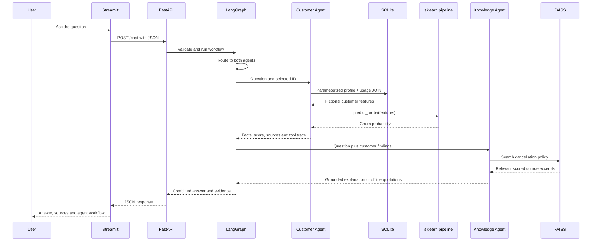
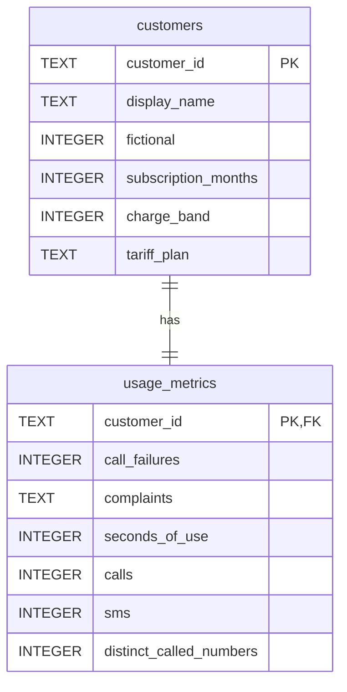

# Telecom Customer Intelligence AI Assistant — explained

This guide is written for someone who can read basic Python but is still learning machine learning, RAG and agents. Read it alongside the code, then use the demonstration near the end to practise for an interview. The [README](README.md) contains the installation and launch commands.

## 1. What problem does this project solve?

A telecom support or analytics user may need two different kinds of information:

1. General information, such as the procedure for disputing a bill or cancelling a subscription.
2. Customer-specific information, such as a customer's recorded usage and estimated likelihood of churn.

**Churn** means a customer leaving a service. A churn model estimates an outcome from recorded features. A language model can explain text, but should not invent customer records or probabilities. This project therefore gives each component a specific responsibility:

| Component | Responsibility |
|---|---|
| SQLite | Store and retrieve fictional customer facts. |
| Scikit-learn | Calculate a churn probability using a trained model. |
| FAISS + Sentence Transformers | Find relevant fictional policy text. |
| Gemini in live mode | Select a route/tools and turn retrieved policy text into an answer. |
| LangGraph | Control the sequence of work and share findings. |
| FastAPI | Expose the functionality through validated HTTP endpoints. |
| Streamlit | Provide a small chat interface. |
| Pytest and evaluation cases | Check that the components behave as expected. |

There is no connection to a real telecom operator. DemoTel, its prices and its app customers are fictional. The separate public training dataset is real, anonymised Iranian telecom data with attribution and a reuse licence. The project does not claim Vodafone affiliation or performance on Vodafone customers.

## 2. Follow one complete question

Consider: **“Predict churn for CUST-001 and explain the cancellation policy.”**



In live mode, Gemini makes routing and tool-selection decisions and generates the policy explanation through the official Google GenAI SDK. In offline mode, rules make those decisions and the answer quotes retrieved text. SQL, model inference, vector search and the same LangGraph run in both modes.

The agents run one after the other for mixed requests. This is intentional: the Knowledge Agent receives the Customer Intelligence Agent's findings before choosing a focused search. Collaboration does not require parallel execution. The combine node preserves the two agents' contributions so a reader can distinguish customer facts from policy evidence.

## 3. Understand the folders before the algorithms

The `telecom` folder is an installable Python package. A command such as `python -m telecom.train` means “run the `train.py` module inside this package.” Installing with `pip install -e .` makes it available while leaving the source editable.

- `data` contains the original training CSV, its provenance, fictional JSON seed records, FAQs and evaluation cases. The generated SQLite file also lives here.
- `models` contains generated binaries: the fitted sklearn pipeline and downloaded embedding model.
- `artifacts/index` contains generated FAISS vectors and the chunk/source manifest.
- `reports` contains actual benchmark numbers, grid-search results, split indices and test/evaluation evidence.
- `tests` contains automated checks. Tests never use a real paid API.
- `logs` contains rotating JSON events produced during execution.

Source files, FAQ/seed data and reports belong in a portfolio repository. Large/rebuildable model files, the database, logs, `.venv` and secrets are ignored by Git. The setup commands regenerate those artifacts after cloning.


### Source modules and important entry points

| File | What to inspect |
|---|---|
| `config.py` | `Settings` and `ROOT`: validated environment settings and location-independent project paths. |
| `schemas.py` | Request, customer, prediction, source and trace contracts. Extra keys are forbidden. |
| `errors.py` | `AppError` carries a safe message/code/status; `CustomerNotFound` maps to a direct-endpoint 404. |
| `prepare_data.py` | `main()`: fetch/reuse CSV, record attribution and content hash. It does not silently manufacture replacement training data. |
| `init_db.py` | `DDL`, `initialise_database()`: related tables, constraints, transactions and idempotent fictional seeding. |
| `ml.py` | `FEATURES`, `load_training_data()`, `CustomerStore.get()`, `Predictor.predict()`: shared training/serving schema, JOIN and probability. |
| `train.py` | `make_pipeline()`, `metrics()`, `train()`: fold-local preprocessing, grouped holdout/CV, search and actual reports. |
| `rag.py` | `chunks()`, `build_index()`, `Retriever.search()`: source chunks, local vectors and scored search. |
| `build_index.py` | Small command-line entry point calling the real index builder. |
| `llm.py` | Structured output schemas and `EvidenceLLM` task/citation policies. |
| `gemini_llm.py` | SDK transport, one-call validation and `native_history()` preservation. |
| `tools.py` | Schemas, `ToolContext`, `tool_spec()`, `ToolExecutor.execute()`: execution boundary and per-request safeguards. |
| `workflow.py` | `State`, `Assistant`, graph nodes and conditional edges; resource caching and response construction. |
| `api.py` | `create_app()`: four routes, middleware, safe errors and readiness checks. |
| `ui.py` | Streamlit chat, optional customer selector, HTTP requests and evidence rendering. |
| `monitoring.py`, `monitor.py` | Correlated JSON events and observed request-latency summaries. |
| `evaluate.py` | `check_case()`, `evaluate_offline()`: 22 deterministic regression cases; `--live` explicitly calls Gemini verification. |
| `evaluate_gemini.py` | Opt-in live cases and `evidence_checks()` comparison against actual tool results. |

`__init__.py` files identify Python packages; they do not contain application behavior. Packaging and test settings live in `pyproject.toml`, with direct and locked dependencies in the two requirements files.

### Shared configuration and schemas

`config.py` defines `ROOT` from the package's file location, so resource paths do not depend on the terminal's current directory. `Settings` reads environment variables and `.env` using Pydantic Settings. Explicit constructor values win over environment values, and environment values win over `.env`.

Important settings are `APP_MODE`, `GEMINI_MODEL`, `GEMINI_API_KEY`, `GEMINI_TIMEOUT_SECONDS`, the embedding model/revision, retrieval threshold and tool budget. Gemini is the only provider. The key is excluded from the settings representation and is not logged; it remains a secret string in server memory. Keep it only in the ignored `.env` file and leave `.env.example` blank of credentials. Environment variables override `.env`, so a stale terminal variable can override a corrected file value.

`schemas.py` defines the data contracts. `ChatRequest` requires a nonblank message of at most 2,000 characters. Customer IDs follow `CUST-` and three digits. `Customer` validates the record fields and requires `fictional=True`. `Prediction`, `Source`, `ToolTrace` and `ChatResponse` describe response shapes. Unknown extra fields are rejected.

Pydantic validates **structure and basic ranges**. It does not prove that a question is safe, a generated sentence is true or a model is accurate. Those require separate controls and evaluation.

## 4. The machine learning pipeline

### 4.1 Where the training data comes from

`prepare_data.py` downloads the UCI Iranian Churn ZIP if the raw CSV is missing. It extracts the CSV and records its SHA-256 checksum and attribution in `data/provenance.json`. A checksum is a content fingerprint; if the source bytes change, the checksum changes.

The public dataset has 3,150 rows. Features aggregate the first nine months, while the label records churn at month twelve. That provides a three-month planning gap. The JSON app customers were authored independently and are not identities attached to public dataset rows.

`load_training_data()` in `ml.py` renames source columns, selects the approved features, converts numeric columns and maps categories:

- `Complains`: 0 becomes `no`, 1 becomes `yes`.
- `Tariff Plan`: 1 becomes `pay_as_you_go`, 2 becomes `contract`.

The seven numeric features are failed calls, subscription months, charge band, call seconds, call count, SMS count and distinct called numbers. The two categorical features are complaint status and tariff plan. Charge band is an ordinal level from 0 to 9, **not an EGP amount**.

Age and Age Group are excluded to keep the example small and avoid directly using age. This does not establish fairness. Status is conservatively excluded because inactivity may be closely related to the target. Customer Value is excluded because its calculation is not documented. The target and customer IDs never enter the features.

### 4.2 Why splitting data matters

If a model is measured on the same examples it learned from, its score may look good without showing that it can generalise. We reserve a test set and keep it out of tuning.

There is another subtle problem: identical predictor rows can appear more than once. If identical rows land in training and test data, the model may effectively see a test example during training. The code hashes each retained feature row to create a group. Identical predictors share a group, even if their recorded labels differ.

`train()` in `train.py` takes the first fold of a five-fold `StratifiedGroupKFold` split with seed 42. Stratification approximately preserves the churn class proportion; grouping keeps matching feature rows together. Grouping means the test count need not be exactly 20%. The actual split is **2,515 training rows and 635 test rows**.

The split indices are saved in `reports/split.json`, allowing tests and reviewers to reproduce the exact holdout. The same grouping rule is used inside cross-validation.

### 4.3 Preprocessing belongs inside the pipeline

`make_pipeline(classifier)` builds:

```text
Input feature DataFrame
  ├── numeric columns → median imputation → standard scaling
  └── categorical columns → most-frequent imputation → one-hot encoding
                         ↓
                    classifier
```

Imputation fills missing values. Scaling subtracts the training mean and divides by the training standard deviation. One-hot encoding turns categories into indicator columns. The scaler is not necessary for Random Forest, but keeps the preprocessing explicit and makes a later Logistic Regression comparison straightforward.

These transformations are fitted **inside** the sklearn pipeline. During cross-validation, each fold learns its own imputation/scaling values only from that fold's training partition. Fitting preprocessing before the split would leak information about validation or test data. The public dataset documents no missing values; supporting them still makes the inference pipeline robust to missing numeric values.

The saved pipeline contains both preprocessing and classifier, so this serving path uses the same fitted transformation. There are deterministic renames/category mappings and feature selection, rather than a bespoke learned feature-engineering stage.

### 4.4 Baseline and model selection

The baseline is `DummyClassifier(strategy="prior")`. It estimates class probabilities from training prevalence. Because churn is the minority, its default predicted class is always retained. This makes its F1 zero on churn and its ROC-AUC 0.5. A baseline is useful because a more complicated model should improve on a simple reference.

The candidate model is a Random Forest with 100 trees and seed 42. A forest combines many decision trees to learn nonlinear relationships without a large neural network.

`GridSearchCV` tries eight combinations:

| Parameter | Candidate values | Intuition |
|---|---|---|
| `max_depth` | 6, unlimited | Limit how complex a tree can become. |
| `min_samples_leaf` | 1, 4 | Require more observations at each leaf to reduce memorisation. |
| `class_weight` | none, balanced | Give the minority class more weight during learning. |

Each combination is checked using three-fold grouped CV on the training partition. F1 selects the winner; the test set is not used to pick parameters or a threshold. Grid search refits the winning pipeline on the whole training partition. This training-only estimator is saved rather than refitting on the holdout.

The winning values were unlimited depth, leaf size 4 and balanced class weights. Mean CV F1 was **0.7818**. CV performance and holdout performance differ because they use different partitions.

### 4.5 What the metrics mean

Churn is the positive class. A true positive means correctly predicting churn.

| Metric | Meaning | Actual Random Forest result |
|---|---|---:|
| Precision | Of predicted churners, how many actually churned? | 0.8696 |
| Recall | Of actual churners, how many did we identify? | 0.8421 |
| F1 | Harmonic mean of precision and recall. | 0.8556 |
| ROC-AUC | Ability to rank churners above retained customers across score thresholds. | 0.9787 |

At probability threshold 0.50, the actual confusion matrix is:

| | Predicted retained | Predicted churn |
|---|---:|---:|
| Actually retained | 528 | 12 |
| Actually churned | 15 | 80 |

For example, precision is `80 / (80 + 12)` and recall is `80 / (80 + 15)`. ROC-AUC uses probability rankings rather than only this one threshold. Accuracy alone can hide poor minority-class detection, so the report includes these metrics and the full matrix.

`metrics()` calculates the values from actual predictions. `reports/benchmark.json` saves them with dataset hash, versions, seed, split details and model parameters. `reports/grid_search.csv` contains the actual CV output. Tests recompute the saved holdout metrics and refit a cloned estimator to verify identical probabilities within numerical tolerance.

These are measurements on one public Iranian dataset split. They do not establish performance for Egypt, Vodafone, future data or the fictional app customers. The probabilities have not been calibrated for a deployment population, and there is no fairness or business-cost audit.

### 4.6 How prediction by customer ID works

`Predictor.__init__()` loads the trusted local Joblib bundle and checks its feature list, model version and prediction interface. A corrupt or incompatible bundle raises an actionable `model_unavailable` error rather than leaking deserialization details. `Predictor.predict(customer)` constructs a one-row DataFrame containing only `FEATURES`, runs `pipeline.predict_proba()`, and takes the probability for class 1. It compares the score with 0.50 to report a class.

The ID is a lookup key, not a model input. For CUST-001, the current fictional record produces a probability of approximately **94.9%**. That is an actual model calculation on invented features, not a measured fact about a real person. A high score does not establish why a customer would leave. The app never claims a causal explanation or a guaranteed retention action.

Joblib can execute code when loading a file, so only trusted model files generated by this project should be loaded.

## 5. SQLite: real customer retrieval with a JOIN

### 5.1 Why two tables?

The database separates relatively stable customer/account fields from observed usage fields:



`customer_id` uniquely identifies each profile. In `usage_metrics`, it is both the primary key and a foreign key referring to the profile table, enforcing at most one usage record per customer. A foreign key prevents an orphan usage record when enforcement is enabled. The app's seed process creates one related record in each table for every demo customer.

`initialise_database()` in `init_db.py` validates the JSON seed records with `Customer`, creates the tables and inserts using placeholders. SQL constraints reject impossible basic values such as a negative charge band. Seeding uses `ON CONFLICT DO NOTHING`, so running it again does not duplicate or overwrite existing demo records. Editing the seed JSON after initialisation does not automatically change an existing database row.

### 5.2 The actual lookup query

`CustomerStore.get()` in `ml.py` executes a query equivalent to:

```sql
SELECT c.customer_id, c.display_name, c.fictional,
       c.subscription_months, c.charge_band, c.tariff_plan,
       u.call_failures, u.complaints, u.seconds_of_use,
       u.calls, u.sms, u.distinct_called_numbers
FROM customers AS c
INNER JOIN usage_metrics AS u ON u.customer_id = c.customer_id
WHERE c.customer_id = ?;
```

`c` and `u` are short aliases. `INNER JOIN` combines rows with the same customer ID. A profile with no matching usage record is not returned by this join. `WHERE` selects the requested customer.

The Python call passes `(customer_id,)` separately from the SQL string. The comma makes it a one-element tuple. SQLite treats the ID as a value, not executable SQL. Building SQL using an f-string containing user input would be unsafe.

The ID is validated before querying and the returned row is validated again as `Customer`. Lookup opens one read-only connection per operation and explicitly closes it using `contextlib.closing`, even for a missing customer. A SQLite connection context manager alone handles transactions but does not close the connection. The seed writer uses both a transaction and explicit closure. Missing databases and invalid stored records produce actionable application errors; missing customers produce a typed 404 on direct endpoints.

Tests go beyond checking that a record comes back: they modify fields in both tables and verify the joined result changes, inspect that the query contains a placeholder with separate parameters, test foreign-key/check constraints, reject SQL-injection-like IDs and confirm repeated seeding preserves rows.

## 6. RAG: answering from evidence

**Retrieval-Augmented Generation** means retrieving relevant source text before asking a language model to answer. It does not retrain the language model on the documents.

The eight FAQs cover billing, payment, cancellation, roaming, plans, plan changes, support and data usage. All are fictional and deliberately include limits, such as not specifying destination-specific roaming prices.

### 6.1 Chunking

`chunks()` in `rag.py` splits each document into at most 50 words with 10 words of overlap. Overlap reduces the chance that a useful detail is lost at a boundary. A short document stays as one chunk. The current source produces 11 chunks.

Every chunk retains a `source_id`, title, reference and excerpt. For example, `faq:roaming:0` identifies the first roaming chunk. These identifiers travel through retrieval, generation and the API response.

### 6.2 Embeddings and FAISS

An embedding is a numeric vector representing text. Related meanings tend to have similar vectors. The local `all-MiniLM-L6-v2` Sentence Transformer maps each chunk to 384 numbers. Its Hugging Face revision is pinned so rebuilding does not silently use a changed upstream revision.

`build_index()` embeds the title and text of each chunk, normalises the vectors, and stores them in a FAISS `IndexFlatIP`. For normalised vectors, the inner product equals cosine similarity. `IndexFlatIP` performs exact search, which is suitable for eleven chunks; a distributed vector database would add unnecessary complexity.

The embedding model is saved in `models/embeddings`, so runtime search works without downloading weights. The index manifest records the source-file hash, index hash, embedding identity/revision, dimension and chunk text. `Retriever.__init__()` checks these before loading and reconstructs the expected chunks from the current FAQ to reject substituted manifest text. A changed FAQ or configuration leads to a clear rebuild error instead of silently serving an old index.

### 6.3 Retrieval

`Retriever.search(query, top_k=3)` embeds the question, searches the index, and retains up to three chunks with similarity at least 0.35. This threshold is a small-demo heuristic, not a calibrated confidence level. A score of 0.6 does not mean a 60% chance that the answer is correct.

The real semantic retrieval checks found the expected documents for roaming, billing, cancellation and plans. An unrelated question about the capital of Mars returned no chunks. This is useful regression coverage but too small to establish broad retrieval quality.

### 6.4 Grounded generation and uncertainty

In live mode, the shared `EvidenceLLM.grounded_answer()` supplies the question and retrieved excerpts through the Gemini adapter. The Gemini adapter inherits these task policies and citation checks. Instructions require using only evidence, refusing absent facts and treating source content as data. On mixed requests it answers the general policy part; the other agent handles customer facts.

The structured output contains `supported`, `answer` and `source_ids`. If no evidence exists, no generation call is made. If the model marks the answer unsupported, the application returns its uncertainty message. Any cited source ID outside the retrieved set is rejected.

These controls reduce hallucination risk but do not mathematically prove every generated sentence follows from the evidence. A model could cite a valid source while misinterpreting it. Gemini smoke checks verify actual tool results, source identities/excerpts and selected expected policy facts; broader answer-quality review remains necessary.

In offline mode there is no text generation: retrieved chunks are displayed verbatim with a clear label. Relevant text may still fail to answer a specific detail. For example, a roaming FAQ can be relevant while explicitly omitting Japan prices. The UI tells users to check whether quoted evidence answers the question.

## 7. The agents and LangGraph workflow

### 7.1 What makes this an agent system?

An agent uses a model to choose actions/tools within an environment. Here, the live LLM chooses among approved operations rather than generating arbitrary executable code. The two specialisations have different permissions:

| Agent | Tools | Output |
|---|---|---|
| Knowledge Agent | `search_faqs` | Grounded FAQ explanation and policy sources. |
| Customer Intelligence Agent | `get_customer`, `predict_churn` | Validated customer facts and an actual model score. |

The customer agent's final facts and probability are formatted by Python. This prevents the LLM from rewriting the numeric score. Its autonomous role is choosing the approved tool sequence. The knowledge agent uses the LLM for both tool selection and grounded wording.

Offline mode replaces model decisions with explicit rules. It is a deterministic development mode, not evidence that an LLM made those decisions.


An **agent** uses the LLM to choose an approved next action. A **tool** is ordinary Python that carries out one bounded task, such as a parameterized lookup. A **workflow** defines legal ordering, state transitions and termination. They are distinct: decorating a function or drawing a graph alone would not establish an autonomous agent. In this project, real Gemini route/function responses supply the decisions and the graph/registry constrain them.

The two agents are specialisations within one application, using one Gemini service. They have different role instructions, tool allowlists, evidence and answer responsibilities. They are not two independently trained models or separate machines. On mixed live requests, the Knowledge Agent receives the customer findings as context for a focused policy search. Offline mode preserves graph collaboration but supplies decisions through rules.

### 7.2 State, nodes and edges

`State` in `workflow.py` is a typed dictionary containing the question, chosen customer ID, route, tool context, agent answers and sources. Each node reads the relevant state and returns updates.

`Assistant.__init__()` builds and compiles this graph:

```text
START → router
  knowledge → knowledge_agent → combine → END
  customer  → customer_agent  → combine → END
  both      → customer_agent  → knowledge_agent → combine → END
  clarify   → clarify        → combine → END
```

`add_conditional_edges()` chooses the next node from state. The graph actually executes Python nodes and tools; it does not just draw an architecture diagram. The graph is compiled once and invoked separately for each request.

### 7.3 Important workflow functions

**`resolve_customer()`** extracts an explicitly written ID or uses the selected customer. It asks for clarification on malformed/multiple/conflicting IDs. The LLM cannot invent an ID to access another record.

**`_route()`** uses `offline_route()` only in offline mode and the selected adapter's shared `route()` in live mode. The live route is validated as one of four labels. Customer routes without an ID become clarification before tools run. `Assistant.llm()` constructs only the selected provider, lazily; offline mode never constructs either client.

**`_run_tools()`** runs the existing bounded loop. In live mode it calls `choose_tool()`, executes through the same registry and appends the real `function_call_output`. The internal result record is translated by the Gemini adapter to a native `FunctionResponse`. The graph does not need provider-specific branches in its nodes or tool loop. It stops on failure, sufficient results or its step limit.

**`_customer_agent()`** collects successful SQL/prediction results, formats them and attaches customer/model references. Unknown customers are explicit errors. It does not invent a replacement record or causal explanation.

**`_knowledge_agent()`** retrieves FAQ evidence and either generates a grounded answer in live mode or quotes excerpts offline. It returns uncertainty when no usable evidence exists.

**`_combine()`** joins the two contributions and their evidence. It uses deterministic formatting rather than another LLM call, keeping cost and the risk of changing numbers lower.

**`chat()`** creates a fresh context, invokes the graph with recursion limit 12, emits correlated events and returns the validated `ChatResponse`. Each request has independent state; there is no persistent conversation memory.

### 7.4 Bounded autonomy and validation

`ToolExecutor.execute()` in `tools.py` is the gate between a proposed action and actual execution. It checks:

1. Is there remaining budget? Invalid attempts count too.
2. Is this tool allowed for this agent?
3. Do the JSON arguments pass their Pydantic schema?
4. Has the exact tool/input combination already been called?
5. Does a customer ID match the user's selected/requested identity?
6. Has customer lookup succeeded before churn prediction?

Only then does it execute the operation. Failures return a structured error instead of executing unchecked input.

The customer planner has at most three steps and the knowledge planner has one. A shared default budget allows at most five tool attempts per request, and the graph has a recursion limit. Provider calls have timeouts and no automatic retries. The only tools are read-only, so the agent cannot cancel subscriptions, change records, run arbitrary SQL or promise a discount.

Questions and retrieved documents are explicitly treated as untrusted data in prompts. This is helpful against prompt injection, but it is not a claim of complete security. The Python allowlist, schema validation and bounded execution remain necessary even if the prompt appears strong.

## 8. Gemini SDK integration and actual autonomy

`llm.py` contains `RouteDecision`, `GroundedAnswer`, `EvidenceLLM` and `agent_instructions()`. It separates task policies from SDK details; it is not another provider. `gemini_llm.py` contains the official `google-genai` client, JSON requests and native function-call history. `Assistant.llm()` lazily constructs only `GeminiLLM` and never constructs it in offline mode.

The chosen model is `gemini-3.5-flash-lite`, which was verified working in the saved live scenarios. Its current availability and free-tier quota are account-specific. No fallback model is selected silently. Configuration belongs in the existing ignored `.env` file:

```dotenv
APP_MODE=live
GEMINI_API_KEY=your_valid_key
GEMINI_MODEL=gemini-3.5-flash-lite
GEMINI_TIMEOUT_SECONDS=30
```

The client receives the key explicitly, so a separate `GOOGLE_API_KEY` does not override it. Restart both servers after non-secret settings change. The audit preserved the existing credential rather than replacing it.

### Structured decisions

`structured()` calls `client.models.generate_content()` with a JSON response schema, then independently validates the returned text with Pydantic. `route()` requests one of four labels, rather than letting the model name arbitrary graph nodes. `grounded_answer()` requests an answer and source IDs, then applies the evidence checks described earlier.

`_config()` limits output to 2,048 tokens, uses a low thinking level on Gemini 3 models and disables SDK automatic function execution. `_generate()` maps provider HTTP failures and timeouts to safe application errors. It logs categories/status/type, not raw response bodies. Retries are disabled, so rate-limit failures cannot secretly multiply requests. A per-call timeout does not imply a whole-workflow deadline; a multi-call request can take longer.

### Function calling step by step

1. Python declares approved tool names, descriptions and schemas with `FunctionDeclaration`.
2. Gemini receives the question, selected ID, permitted declarations and any prior customer findings.
3. Gemini proposes one function name and JSON arguments. It has not executed Python or SQL.
4. `ToolExecutor.execute()` validates the proposal and executes the actual operation if permitted.
5. `_run_tools()` appends the real result to request-local history. `native_history()` turns that record into a Gemini `FunctionResponse` for the next planning step.
6. The loop stops when enough work is complete, an error occurs or a step/budget limit is reached. The final combine node uses Python formatting.

The initial tool step uses `ANY` to require a proposal. Later customer steps use `AUTO`, allowing the agent to stop after a lookup when no risk prediction was requested. Multiple calls in one step are rejected. These choices create bounded autonomy: the model chooses a route and permitted action, while Python controls execution and limits.

`native_history()` preserves complete model `Content` objects, including opaque thought signatures. Some models need this metadata when a function conversation continues. It is preserved without being interpreted as an instruction. Reconstructing only the function name/arguments could lose that metadata. History belongs to each request, so two customers do not share a mutable conversation buffer.

### Evidence levels and live verification

Default tests use the real SDK with `httpx.MockTransport` and explicitly simulated provider responses. They test payloads, history, source validation, errors and graph integration with real local tools. They do not prove model reasoning.

The preserved seven-case live report (`reports/gemini_live_evaluation.json`) contains actual Gemini answers, tools and sources from before final cleanup. All seven passed then: FAQ, customer lookup, prediction, combined question, unknown customer, unknown price and malformed ID. CUST-001's real pipeline score was `0.9493094876793147`, displayed as 94.9%. The malformed-ID case deliberately used no provider call.

For fresh post-cleanup verification with limited quota, run:

```powershell
.\.venv\Scripts\python.exe -m telecom.evaluate_gemini --case combined --case unsupported_price
```

The limited result is saved separately as `reports/gemini_live_audit.json`. A full explicit run (`python -m telecom.evaluate --live`) executes the seven-case suite and updates its report. A 15-second pause separates cases; individual requests are not retried.

The evaluator observes actual registry calls. It compares customer sources to the SQL JOIN, score sources and displayed percentages to sklearn, and FAQ excerpts/IDs to the executed FAISS search. It checks selected expected policy facts and uncertainty for absent prices. Tests deliberately alter excerpts and scores to show that these checks fail when evidence is fabricated. Source membership and a few fact checks still do not prove every sentence is entailed or every paraphrase is handled.

The initial 3.8 Flash generation failures are retained in `reports/gemini_live_evaluation_initial_3_8.json` as historical evidence, not current-model results. The final audit distinguishes all historical reports from fresh checks.

Only fictional app data is sent to Gemini. Raw question/tool payloads are omitted from application logs, but they do reach the external provider in live mode. Free-tier data-use terms and quotas should be reviewed before using any other data. A successfully authenticated request does not by itself establish a billing tier.

## 9. APIs and the user interface

### 9.1 FastAPI responsibilities

`create_app()` in `api.py` constructs the application and shares an `Assistant` service. Route functions are small because business logic lives in the lower-level modules.

| Route | Flow |
|---|---|
| `GET /health` | Load/check SQLite, model and semantic index; report readiness. |
| `POST /chat` | Validate message → graph → answer/evidence/tool trace. |
| `GET /customers/{customer_id}` | Validate ID → SQL JOIN → `Customer`. |
| `POST /predict` | Validate ID → SQL lookup → fitted pipeline → `Prediction`. |

HTTP is the communication protocol. REST endpoints expose resources/operations; JSON is the data format. For example, `{"customer_id":"CUST-001"}` is the request body for prediction. FastAPI builds interactive documentation at `/docs` from the route and Pydantic definitions.

422 means the input failed validation. 404 means a direct lookup did not find the customer. 503 indicates a missing artifact or unavailable provider. Unexpected failures receive a sanitized 500. A chat with a failed subtask can still return HTTP 200 and partial findings; clients must inspect the `errors` list and trace rather than relying only on HTTP status.

The health endpoint checks local resources and reports Gemini, its model and whether its key is configured. It does not make a Gemini request or claim that a present key is valid. Missing or invalid artifacts are readiness failures; an already loaded resource is cached until server restart.

### 9.2 Streamlit responsibilities

`ui.py` is an HTTP client. It never opens SQLite or loads the ML model. The sidebar lets a user choose a fictional customer and see the backend mode. The chat sends JSON to FastAPI using `httpx` and shows answers, source excerpts and the tool trace.

The displayed chat history is a UI convenience, limited to recent messages. That history is not submitted to the graph as conversational memory. Questions remain independent; “What about this customer?” without an ID or selected customer may need clarification.

Keeping UI and backend separate demonstrates an API boundary and lets a different client reuse the same prediction service. This remains a local demo, not a production microservice architecture.

## 10. Monitoring and evaluation

`monitoring.event()` writes one JSON object per event to `logs/app.jsonl`. Events include timestamps, request IDs, route/tool choices, status, errors and latency. Requests share a correlation ID across graph, tools and HTTP logs. UTC timestamps include their offset, while evaluation report run times use Africa/Cairo.

Raw customer records, questions and API keys are omitted from logs. Logs rotate after 1 MB and keep two backups. `python -m telecom.monitor` calculates actual request counts, success/failure counts and p50/p95 latency from retained log entries.

These statistics include development and deliberately failing tests. A high failure count after testing can be expected, and a latency percentile from those requests is not a production performance benchmark. Cold embedding/model loading also makes initial requests slower than warmed requests.

`data/evaluation_cases.json` defines 22 transparent regression cases. `evaluate_offline()` runs them against real local components and saves individual results in `reports/evaluation.json`. All **22/22 passed** during development. Cases cover retrieval, routes, SQL records, prediction consistency, combined workflows, unknown IDs, invalid input, lookup dependencies, duplicate calls, budgets and tool permissions.

Keep these evaluation categories distinct:

| Evaluation | What it measures | What it does not prove |
|---|---|---|
| Held-out ML benchmark | Classification performance on public-data holdout. | Egypt/Vodafone/general deployment performance. |
| Offline regression cases | Expected application behavior on 22 cases. | Live LLM decision or answer quality. |
| Automated SDK contract tests | Integration with simulated provider payloads. | Successful real provider responses. |
| Optional live smoke checks | Small provider-backed workflow checks. | Robustness across all user questions. |

## 11. Tests: what passing means

The executed command was:

```powershell
.\.venv\Scripts\python.exe -m pytest -q --junitxml=reports/pytest.xml
```

The post-cleanup result is **88 passed in 32.15 seconds**, with four upstream deprecation warnings and no failed tests. Obsolete provider-only tests were removed; new audit tests check full tuning reproduction, baseline metrics, corrupted artifacts, SQLite closure and saved data consistency.

| File | Important behavior checked |
|---|---|
| `test_ml.py` | Group separation, real benchmark recomputation, seeded refit, preprocessing, stable prediction, missing model. |
| `test_sql.py` | Actual JOIN, placeholder parameters, constraints, injection-like input, idempotent seeding, missing data. |
| `test_rag.py` | Chunk overlap, real semantic hits, irrelevant query rejection, missing/stale index. |
| `test_workflow_tools.py` | Routing, combined agents, conflicting IDs, failures, allowlists, budget and duplicate protection. |
| `test_api.py` | Real endpoint behavior, input validation, sources/headers, correlated logs, 404/503 errors. |
| `test_gemini_contract.py` | Google SDK requests, native history/signatures, one-call enforcement, lazy Gemini construction, errors, timeouts and no retries. |
| `test_gemini_evaluation.py` | Live-check validator rejects changed source excerpts and invented model probabilities, without calling a live provider. |
| `test_ui.py` | Streamlit renders and sends a chat to a real FastAPI server on an ephemeral loopback port. |

The autouse fixture blocks external socket connections and puts embedding libraries into offline mode. Local loopback connections and mock transports remain allowed. Thus tests require the previously built local model/index/database, but no paid key or external service.

Tests are evidence about the scenarios they exercise, not a guarantee that no bugs exist. Python 3.12.9 on Windows is the verified environment; upstream deprecation warnings remain documented.

## 12. A practical interview demonstration

Prepare the environment and artifacts using the README, then start FastAPI and Streamlit in two terminals. Use offline mode unless valid live credentials have been verified.

1. Open `/health` and explain that the API is checking real local resources, not returning a hardcoded “OK”.
2. Ask **“How do I activate international roaming?”** Show the FAQ source and explain embeddings, retrieval and the explicit offline/live difference.
3. Ask **“Predict churn for CUST-001.”** Expand the workflow to show lookup followed by prediction. Explain that SQLite joins two tables and the pipeline calculates the number.
4. Ask **“Predict churn for CUST-001 and explain the cancellation policy.”** Show both agents, the shared findings and combined evidence.
5. Ask about **CUST-999** to demonstrate a real failure. Then ask for churn without an ID to demonstrate clarification.
6. Open `reports/benchmark.json`, the split manifest and grid CSV. Explain the baseline, group leakage protection and the difference between CV and held-out metrics.
7. Run tests/offline evaluation and show the reports. Distinguish fresh limited Gemini verification, the earlier seven-case live report and simulated-provider tests. Explain why repeating a smoke set is not a large-scale quality evaluation.

Do not claim that an agent autonomously made a model decision while demonstrating offline mode. Do not describe fictional offers as real operator plans. These distinctions make the demonstration more credible.


### Six concrete question walkthroughs

These examples correspond to the saved real seven-case Gemini run and the current local regression behavior. The limited final live audit rechecks mixed retrieval/prediction and uncertainty; it does not rerun every historical example.

**1. “How do I activate international roaming?”** The live router selects `knowledge`. The Knowledge Agent proposes `search_faqs` with a focused query. Local embeddings and FAISS return `faq:roaming:0`. Gemini explains enabling roaming in the app, confirming coverage and activating a bundle before use. The source ID is checked before the API returns it. In offline mode the UI shows the retrieved excerpt instead of claiming generated reasoning.

**2. “Show the profile for CUST-002.”** Identity resolution finds one well-formed ID. The router selects `customer`; Gemini requests `get_customer`. SQLite joins the profile and usage tables. The record is validated and Python displays Demo Customer B, 36 subscription months, a contract tariff, no recorded complaint and one failed call. Its source is the actual joined record; no prediction is necessary. The agent can stop with `AUTO` after obtaining enough facts.

**3. “Predict churn for CUST-001.”** The Customer Intelligence Agent first looks up the record, then proposes `predict_churn`. The executor refuses prediction if lookup has not succeeded. The fitted nine-feature pipeline calculates `0.9493094876793147`; Python displays 94.9% with threshold 0.50 and the population caveat. The model source includes its saved version. The high score does not establish a causal reason for leaving.

**4. “Predict churn for CUST-001 and explain the cancellation policy.”** The route is `both`. Customer lookup and prediction complete first. Their findings enter shared state and are included in the Knowledge Agent's tool-selection context. It searches cancellation policy, then Gemini explains support/store requests, identity verification, outstanding balance and a possible contractual fee from that evidence. `_combine()` joins the two sections and sources without another generative call. There is no cancellation action.

**5. “What is the exact DemoTel roaming price in Japan?”** The router selects `knowledge`. Retrieval may find a related roaming excerpt, but it does not contain that destination's price. The grounded answer marks the question unsupported, so the application returns uncertainty with no invented rate or supporting citation. Similarity alone would not justify making up a number.

**6. “Predict churn for CUST-999.”** The syntactically valid ID reaches the customer lookup tool, which returns `customer_not_found`. Prediction never runs and no customer/model source is invented. `/chat` returns its structured error result with HTTP 200; a direct `/customers/CUST-999` request returns 404. “Predict churn for CUST-1” instead triggers format clarification before any model/tool call. This difference is useful to demonstrate API versus workflow error semantics.

## 13. Questions you should be ready to answer

**Why use RAG instead of asking the LLM directly?** Policies are explicit evidence. Retrieval makes source inspection possible and avoids relying solely on the model's remembered facts.

**Why keep the churn model separate from the LLM?** The sklearn model produces a reproducible numeric result from defined features. The language model should select tools and explain evidence rather than invent probabilities.

**Why use grouped splits?** Identical feature rows should not appear in both training and validation/test partitions, where they could exaggerate generalisation.

**Why F1 and ROC-AUC?** Churn is a minority class. F1 reflects precision/recall at the chosen threshold; AUC evaluates ranking across thresholds. Neither directly measures business profit.

**What is the difference between RAG embeddings and the churn model?** Embeddings map text to vectors for similarity search. The churn model maps structured customer features to a churn probability. They are different trained models serving different tasks.

**What makes the SQL safe?** The ID is validated and passed as a bound parameter. Runtime SQL is fixed, connections are read-only, and the LLM is not allowed to write arbitrary SQL.

**What happens if the LLM proposes a bad tool call?** Python validates it before execution. Unknown/disallowed tools, wrong IDs, invalid arguments, repeated calls and excessive attempts become explicit errors.

**Is this fully autonomous?** It has bounded autonomy over a small set of read-only actions. It cannot perform account changes or recursively delegate unlimited work.

**Is it production ready?** No. It is a local portfolio project. Production would require authentication, access control, privacy review, calibrated risk scores, broader evaluations, concurrency/load testing and operational monitoring. Those are deliberately outside this small scope.

**What remains unverified?** Broad language-model accuracy, production security/load behavior and performance on Egyptian customers. Gemini access and free-tier quotas may change. These limits are explicit in the final audit.

## 14. What to study in the code, in order

Start with `schemas.py` and `config.py` for shapes/settings. Read `init_db.py` and `CustomerStore.get()` for SQL; `make_pipeline()`, `train()` and `Predictor.predict()` for ML; and `chunks()`, `build_index()` and `Retriever.search()` for retrieval. Then follow `ToolExecutor.execute()`, the shared `EvidenceLLM`, `GeminiLLM.choose_tool()` and `Assistant.__init__()` to see model decisions turn into validated work. Finish with `api.py`, `ui.py`, both evaluation commands and the tests.

The key design idea is that every kind of answer has a concrete origin: customer facts come from SQL, risk comes from the saved ML pipeline, and policy statements come from retrieved documents. LangGraph coordinates these components, FastAPI exposes them, and the interface lets a reviewer inspect the evidence.

## 15. Why these technologies, and reasonable alternatives

| Choice | Reason in this project | Limitation / reasonable alternative |
|---|---|---|
| LangGraph | Explicit state/conditional edges make the multi-step handoff inspectable. | More concepts than a direct function chain; ordinary functions would suffice for a fixed single-path script. |
| Gemini function calling | Produces actual structured action proposals with the official SDK. | Remote service, variable latency, quotas and possible mistakes. A local instruction model would need separate serving and tool-quality validation. |
| Sentence Transformers + FAISS | Small, local semantic retrieval with exact search over eleven chunks. | Weak coverage evidence at this scale; TF-IDF/BM25 is a useful lexical baseline, and a managed vector database would only be justified by larger operational needs. |
| SQLite | Demonstrates relational keys, JOINs and parameter binding with no separate server. | Not a shared production customer store; PostgreSQL is reasonable when concurrency and access control require it. |
| Random Forest | Small nonlinear tabular classifier, straightforward tuning and persistence. | Probability calibration and interpretability need further work. Logistic Regression is a sensible simpler comparison; gradient boosting is another candidate requiring the same honest validation. |
| FastAPI + Pydantic | Typed JSON contracts, validation and generated API docs. | Authentication and production operations are not supplied by this demo. Flask is a simpler alternative with more validation wiring. |
| Streamlit | Compact Python UI for an interview demonstration. | Limited UI control and rerun semantics; a web frontend would add effort without improving the current analytical objective. |
| Joblib | Stores preprocessing and classifier together. | Unsafe for untrusted binaries; safer interchange formats require compatibility checks and are outside this demo. |
| JSON logs | Easy to inspect request IDs, choices and latency locally. | No alerting or multi-process aggregation. Production observability would need operational requirements first. |

### Interview questions for a telecom/data graduate role

These are practice questions relevant to this project, not a claim to know Vodafone's actual interview questions.

**How would you choose a retention threshold?** The demo fixes 0.50. A business choice needs the cost of contact/offer, value of retaining a customer, false-positive cost and validation of whether an intervention works. Optimise expected value on validation data, then report untouched-test performance; do not choose it by repeatedly inspecting the test set.

**Would you deploy this model on Egyptian customers?** Not on these results alone. Obtain permitted representative data, check feature definitions and drift, measure calibration and subgroup behavior, choose a cost-sensitive threshold and validate intervention outcomes. The current Iranian holdout only supports claims about that sample/split.

**Why can high ROC-AUC still be insufficient?** Ranking can be strong while probabilities are poorly calibrated or a chosen threshold produces an unsuitable precision/recall tradeoff. Deployment value also depends on data shift and business cost, none of which is proven by the single number.

**Does a complaint cause churn here?** The model is observational. Correlation or a high score does not establish causation, and this application does not produce causal explanations. A causal retention claim would require an appropriate study, such as a permitted randomised intervention.

**How would you evaluate RAG beyond this demo?** Use held-out questions, known relevant documents, out-of-scope cases and human-reviewed answers. Measure retrieval hit/recall, citation correctness, semantic support, abstention quality and latency/cost. Keep a separate regression set from the examples used to choose a retrieval threshold.

**What if Gemini requests a cancellation or another customer's ID?** No cancellation tool is registered. The allowlist blocks unknown actions, input validation rejects malformed arguments, and selected-ID binding rejects a different customer. These are enforced in Python, not only requested in the prompt. The ID binding is still not real authentication.

**Where is the model deployed?** A local FastAPI process loads the saved sklearn pipeline and embeddings on CPU. Gemini is a remote text service. The API itself is not hosted publicly and there is no cloud deployment, SLA or load-test claim.

**What would you improve next if this became a real service?** Start with lawful representative data and clear access/privacy requirements, then broader evaluation, authentication, calibrated risk scores and operational reliability. Adding infrastructure before those requirements would not fix model or data validity.
