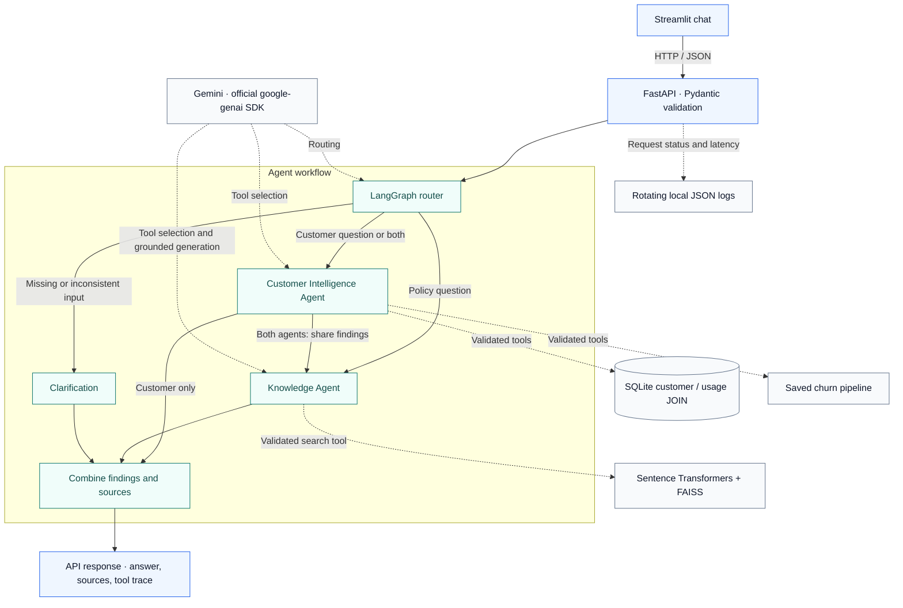
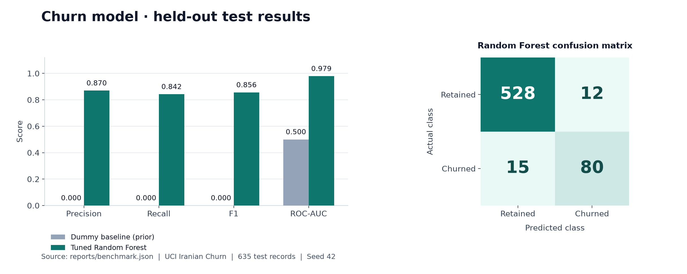
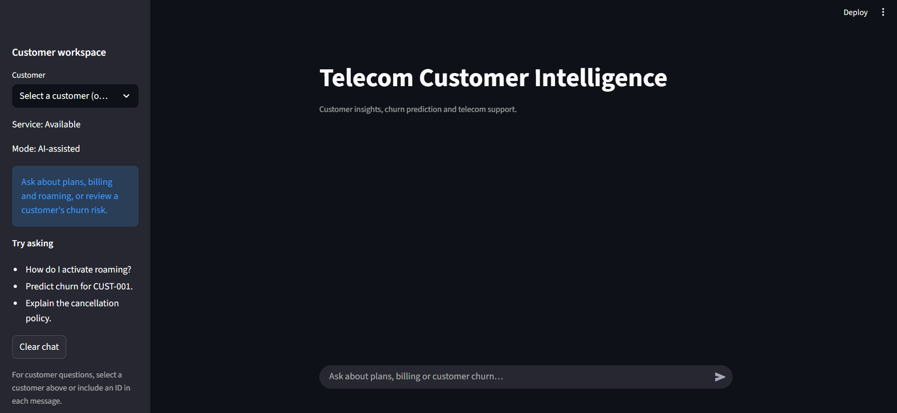
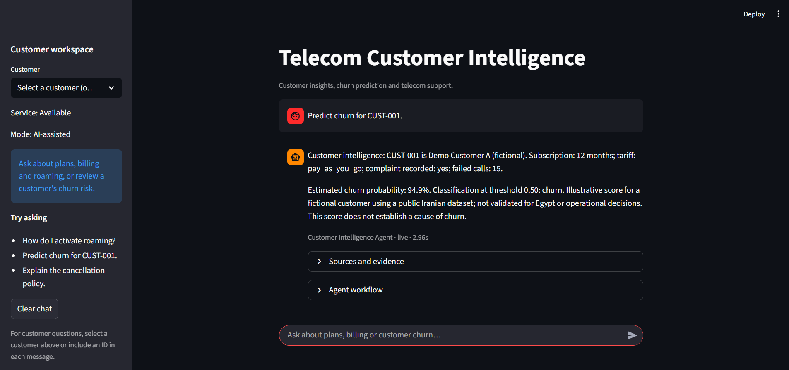
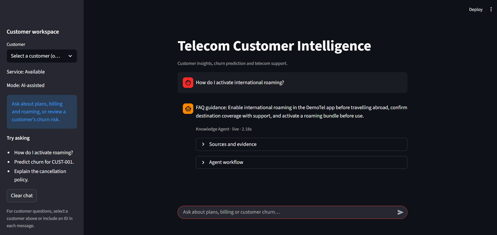
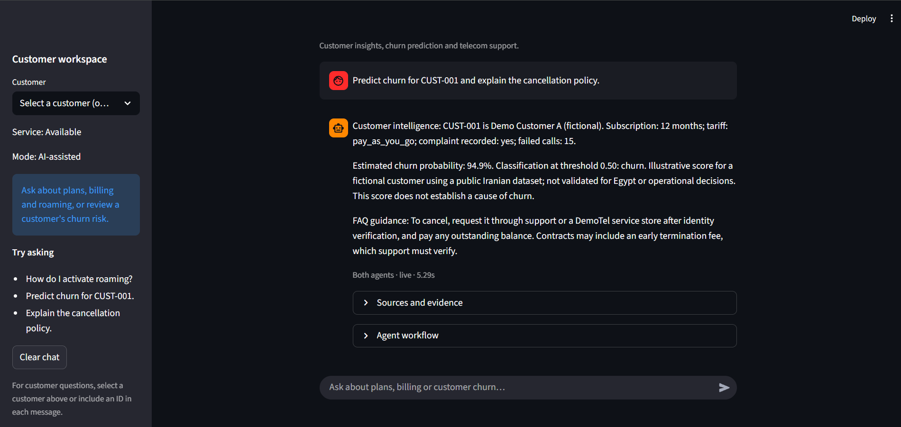

# Telecom Customer Intelligence AI Assistant

**[Try the Hosted Demo (Offline Mode)](https://amrafik-telecom-ai.streamlit.app/)**

**Telecom policy answers, customer lookup and churn prediction in one conversation.**

A telecom assistant that combines two LangGraph agents, FAQ retrieval and a trained churn model. It answers policy questions, retrieves customer profiles through SQLite and calculates churn risk with a saved Scikit-learn pipeline.

The **public hosted demo** uses deterministic offline routing and executes real SQLite lookups, Scikit-learn predictions, FAISS retrieval and LangGraph workflows, with **no Gemini API calls**. The **full local application** supports Gemini-powered agent routing, function calling and grounded response generation, with [recorded live verification](reports/gemini_portfolio_smoke.json).

FastAPI exposes the tools and workflow; Streamlit presents the answer, sources and execution trace. A mixed question such as “Predict churn for CUST-001 and explain the cancellation policy” runs customer lookup, model inference and policy retrieval in sequence.

**Independent portfolio project.** No Vodafone affiliation or private Vodafone data. The six demonstration customers and eight DemoTel FAQs are fictional; the churn model is trained on a public, anonymised dataset.

[Architecture](#architecture) · [Screenshots](#interface-screenshots) · [Model results](#model-results) · [Setup](#getting-started) · [Test evidence](#testing-and-verification) · [Project guide](PROJECT_EXPLAINED.md) · [Demo options](docs/DEMO_OPTIONS.md)

## Architecture

The diagram shows the full local workflow. Its Gemini connections apply only to local live mode; the hosted demo uses deterministic routing and tool selection with the same graph and local tools.



The agents have different prompts, permissions and responsibilities. The Customer Intelligence Agent can call `get_customer` and `predict_churn`; the Knowledge Agent can call `search_faqs`. For mixed requests, customer findings enter shared graph state before the policy step. This is sequential collaboration inside one application.

In local live mode, Gemini proposes function calls; the application validates and executes them. Safeguards include Pydantic schemas, tool allowlists, customer-ID matching, lookup before prediction, duplicate-call detection and a shared budget of five tool attempts. Customer planning is capped at three steps, knowledge search at one, and graph recursion at 12. SDK automatic function execution and automatic retries are disabled.

### Retrieval and grounding

Eight authored FAQs are split into 11 overlapping chunks of up to 50 words. A pinned `all-MiniLM-L6-v2` Sentence Transformer produces 384-dimensional embeddings. FAISS searches normalised vectors using inner products, equivalent to cosine similarity.

The default search returns up to three results above a 0.35 similarity threshold. In local live mode, Gemini receives the retrieved excerpts and must cite retrieved source IDs. Missing evidence or an unsupported answer produces uncertainty. The hosted offline demo returns retrieved excerpts rather than generated answers. The threshold is a retrieval heuristic; valid citations alone do not prove that every generated sentence is supported.

## What it does

| Ask the assistant | What runs behind the answer |
|---|---|
| “How do I activate international roaming?” | The Knowledge Agent searches local FAQ vectors and generates an answer grounded in retrieved excerpts. |
| “Show the profile for CUST-002.” | The Customer Intelligence Agent retrieves a profile through a parameterised SQLite JOIN. |
| “Predict churn for CUST-001.” | Customer lookup runs first, followed by inference with the saved Scikit-learn pipeline. |
| “Predict churn for CUST-001 and explain the cancellation policy.” | Both agents run in sequence and combine customer findings with cited policy guidance. |
| “What is the exact DemoTel roaming price in Japan?” | The assistant should express uncertainty because the FAQ does not contain that price. |
| “Predict churn for CUST-999.” | Customer lookup reports a missing record; no prediction or customer evidence is invented. |

Tools are read-only. The assistant cannot change accounts, cancel a service or apply an offer.

You can also ask **“What can you do?”** or **“How do you work?”** Unrelated requests receive a short scope explanation; a follow-up such as **“Why not?”** explains the boundary. Local live mode uses Gemini's validated intent classification, then application-owned replies about verified capabilities—no extra generation call or tools for these cases. Offline mode uses explicit deterministic rules and labels these replies accordingly. The API returns an `intent` alongside the existing four-way graph `route`.

Both interfaces send only the latest scope-refusal intent as a bounded follow-up hint. They do not send chat history, inherit customer IDs or add persistent conversational memory; each customer task still requires an explicit or selected ID.

## Model results

The churn model uses the [UCI Iranian Churn dataset](https://archive.ics.uci.edu/dataset/563/iranian+churn+dataset): 3,150 anonymised records under [CC BY 4.0](https://creativecommons.org/licenses/by/4.0/). Features cover the first nine months; the churn label is measured at month twelve. Attribution, the source checksum and the feature dictionary are in [data/README.md](data/README.md) and [data/provenance.json](data/provenance.json).



| Model | Precision | Recall | F1 | ROC-AUC |
|---|---:|---:|---:|---:|
| DummyClassifier (`prior`) | 0.0000 | 0.0000 | 0.0000 | 0.5000 |
| Tuned Random Forest | **0.8696** | **0.8421** | **0.8556** | **0.9787** |

These are the saved results on **635 held-out rows**, with 2,515 rows used for training. The baseline predicts the majority class, which explains its zero precision, recall and F1 for churn.

The pipeline retains seven numeric and two categorical features. Numeric imputation/scaling and categorical imputation/one-hot encoding are fitted inside each training fold. IDs and target labels are excluded, along with age, status and the undocumented derived customer-value field.

Identical feature rows stay in the same group during both the outer split and cross-validation. `GridSearchCV` evaluates eight Random Forest configurations with three-fold grouped CV on the training partition, selecting by F1. The winning model has 100 trees, unrestricted depth, a minimum leaf size of four and balanced class weights. Mean CV F1 is **0.7818**; the classification threshold is fixed at 0.50. The saved estimator is fitted to training rows only.

Reproducibility records: [benchmark metrics](reports/benchmark.json), [grid-search results](reports/grid_search.csv) and [split indices](reports/split.json). The chart is generated directly from the benchmark by [scripts/render_benchmarks.py](scripts/render_benchmarks.py), using Matplotlib as an optional documentation dependency in a separate environment.

These results describe this public Iranian sample. They do not establish performance for Egypt, Vodafone customers or the fictional application records. Probabilities are uncalibrated and have not been validated for operational decisions.

## Interface screenshots

Real captures supplied by the project owner from the local live-mode application. The image files are preserved without edits. The source and workflow panels are collapsed in these captures; executed-tool and grounding checks are recorded separately in the evaluation reports.

### Customer workspace



The customer selector is optional when the question already includes a customer ID.

### Churn prediction



The saved pipeline calculates an illustrative 94.9% score for this fictional customer; the answer includes its dataset limitations.

### RAG policy answer



A roaming question is answered from the fictional FAQ collection. In the running app, expand **Sources and evidence** to inspect the retrieved excerpts.

### Both agents in one request



The response combines customer analytics with cancellation guidance. **Agent workflow** exposes the underlying tool trace; the supplied capture shows that panel closed.

## Technology stack

| Layer | Implementation |
|---|---|
| Language | Python 3.11–3.12; verified on Windows with Python 3.12.9 |
| LLM (local live mode only) | Gemini `gemini-3.5-flash-lite` through official `google-genai` 2.33.0 |
| Orchestration | LangGraph 1.0.3 |
| API and validation | FastAPI 0.121.3, Uvicorn, Pydantic 2.12.5 |
| Interface | Streamlit 1.51.0 |
| Machine learning | Scikit-learn 1.7.2, Pandas, NumPy and Joblib |
| Retrieval | Sentence Transformers 5.1.2, CPU PyTorch and FAISS 1.12.0 |
| Storage and tests | Python `sqlite3`, Pytest and HTTPX |

Direct dependencies are pinned in [requirements.txt](requirements.txt); [requirements-lock.txt](requirements-lock.txt) records the audited environment. Python 3.13+ is outside the supported range. Python 3.11 has not been verified; separate Ubuntu Linux cloud checks are documented below.

## Getting started

### 1. Install on Windows

Use Python 3.12 and open a PowerShell terminal. Git must be installed to clone the repository.

```powershell
git clone https://github.com/Amrafik/telecom-customer-intelligence-ai-assistant.git
cd telecom-customer-intelligence-ai-assistant

python --version
python -m venv .venv
.\.venv\Scripts\python.exe -m pip install torch==2.5.1 --index-url https://download.pytorch.org/whl/cpu
.\.venv\Scripts\python.exe -m pip install -r requirements-lock.txt
.\.venv\Scripts\python.exe -m pip install -e . --no-deps

if (-not (Test-Path -LiteralPath .env)) { Copy-Item -LiteralPath .env.example -Destination .env }
```

In VS Code, install the Python extension and select `.venv\Scripts\python.exe` with **Python: Select Interpreter**. These commands use the interpreter directly, so activation is optional. Initial installation requires network access and several hundred MB for dependencies and embedding weights. A fresh installation on a separate machine has not yet been verified.

### 2. Build local resources

Run these commands in order from the repository root:

```powershell
.\.venv\Scripts\python.exe -m telecom.prepare_data
.\.venv\Scripts\python.exe -m telecom.init_db
.\.venv\Scripts\python.exe -m telecom.train
.\.venv\Scripts\python.exe -m telecom.build_index
```

The included public CSV is reused if present. These commands record provenance, seed the fictional SQLite database, save the trained churn pipeline, and download the pinned embedding model to build the FAQ index. Runtime retrieval then uses local model files. Rebuild the index after changing FAQ content or embedding settings.

Generated models, embeddings, the index, SQLite database, logs and `.env` are excluded from Git. They are recreated locally from the included source data and seeds. Database seeding preserves existing rows.

### 3. Choose a mode

| Setting | Behaviour |
|---|---|
| `APP_MODE=offline` | Deterministic routing, fixed tool-selection rules and retrieved excerpts. The real graph, SQL, model and vector search still execute. No Gemini calls. |
| `APP_MODE=live` | Gemini performs routing, function selection and grounded policy generation. Python executes tools and formats customer/model facts. |

The example configuration defaults to offline mode. For live mode, obtain a key from [Google AI Studio](https://aistudio.google.com/apikey) and edit the ignored `.env` file:

```dotenv
APP_MODE=live
GEMINI_API_KEY=your_key_here
GEMINI_MODEL=gemini-3.5-flash-lite
GEMINI_TIMEOUT_SECONDS=30
```

Keep the real key out of source files and `.env.example`. Existing environment variables override `.env`; restart the servers after configuration changes. Model access, free-tier eligibility and quotas depend on the account. There is no silent fallback to another model or mode.

### 4. Start the application

In one terminal, start the backend:

```powershell
.\.venv\Scripts\python.exe -m uvicorn telecom.api:app --host 127.0.0.1 --port 8000
```

In a second terminal, start the interface:

```powershell
.\.venv\Scripts\python.exe -m streamlit run telecom/ui.py --server.address 127.0.0.1 --server.port 8501 --browser.gatherUsageStats false
```

Open the [chat interface](http://127.0.0.1:8501), [interactive API documentation](http://127.0.0.1:8000/docs) or [health endpoint](http://127.0.0.1:8000/health). First use may take several seconds while local resources load. Stop each server with Ctrl+C.

These commands run the original local application without authentication. Keep both services bound to `127.0.0.1`.

## REST API

| Method and endpoint | Purpose |
|---|---|
| `GET /health` | Check database, churn model and FAQ index readiness; report mode and configured model. Does not call Gemini. |
| `POST /chat` | Accept a message, optional customer ID and optional bounded `previous_intent`; return answer, classified intent, graph route, sources, tool trace, errors, request ID and latency. |
| `GET /customers/{customer_id}` | Return a validated fictional customer profile using the SQLite JOIN. |
| `POST /predict` | Return churn probability, predicted class, threshold, model version and a dataset caveat. |

For example, with the backend running:

```powershell
Invoke-RestMethod -Method Post -Uri http://127.0.0.1:8000/chat -ContentType "application/json" -Body '{"message":"Predict churn for CUST-001 and explain the cancellation policy."}'
```

Customer IDs follow `CUST-001`. Invalid payloads return 422; unknown customers return 404 on direct lookup/prediction. Unavailable dependencies/provider failures return 503 where handled at the API boundary. Chat can return HTTP 200 with partial findings or explicit tool errors, so consumers must inspect `errors` and `tool_trace`. Unexpected exceptions produce a sanitised 500 response.

## Testing and verification

Build the local resources before running the suite:

```powershell
.\.venv\Scripts\python.exe -m pip check
.\.venv\Scripts\python.exe -m pytest -q --junitxml=reports/pytest.xml
.\.venv\Scripts\python.exe -m telecom.evaluate
```

Recorded checks on **23 October 2026**:

[Consolidated intent-handling verification](reports/intent_verification.json) records the current checks, preserved artifacts and limitations.

| Check | Result | Scope and evidence |
|---|---:|---|
| Automated suite | **173 passed** | Local regression, simulated-provider integration and cloud wrapper tests, including the 36 evaluation cases. [Current JUnit report](reports/intent_regression.xml); earlier 143/123-test reports are preserved. |
| Offline evaluation | **36 / 36** | Real SQL, inference, vector retrieval and rule-based orchestration; zero Gemini calls. [Case report](reports/evaluation.json). |
| Mocked Gemini SDK contracts | **29 / 29**, included in the 173 | Simulated HTTP responses exercise the official SDK, validated intents and real local tools; they do not prove live decisions. [JUnit report](reports/intent_regression.xml). |
| Limited real Gemini smoke check | **5 / 5** | Four scope/self-description intents plus a combined telecom request; nine generation calls and one model-availability lookup. [Current live report](reports/gemini_intent_smoke.json). |
| Linux cloud/conversation regression | **38 passed** | Ubuntu WSL subset, repeated on Linux with zero Gemini calls. [Linux JUnit report](reports/intent_linux_pytest.xml). |
| Earlier interactive live checks | **10 / 10 + 2 / 2 HTTP checks** | Preserved earlier run; not rerun in full for this pass. [Earlier evidence](reports/live_prompt_regression.json). |

The automated suite blocks external sockets and uses simulated responses for Gemini SDK contracts. Its remaining tests exercise local components, including deliberate failure injection; some tests replace dependencies to isolate error handling. No default test calls the live provider. The 29 mocked-SDK cases are included in the 173 tests, not an additional test run. Saved live reports check tool execution against SQL rows, pipeline output and retrieved evidence. They are small smoke tests, not an exhaustive answer-quality or security evaluation. The latest Windows run took **48.16 seconds** with four upstream deprecation warnings; the Linux subset took **11.58 seconds** with seven warnings.

The 36-case catalogue covers all eight FAQ topics, unsupported input, customer lookup, repeated predictions, tool permissions/dependencies/budgets and multi-agent partial results, plus scope replies, capabilities, architecture, refusal follow-ups, greetings and recovery to a supported task. The missing-model case points the real loader at an absent temporary file; it does not remove the working model or invent an error response. Offline excerpts are not a semantic answerability test: a document can be relevant without containing the requested price.

Live checks are opt-in and consume API quota. The current five-scenario run used one generation call for each scope intent and five for the combined request. The refusal follow-up used the actual preceding out-of-scope result; non-task replies executed no tools. The combined request executed `get_customer → predict_churn → search_faqs` and verified returned customer/model/FAQ evidence. Earlier live reports remain unchanged, including the previous 1/1 portfolio smoke; an interrupted earlier attempt is not counted as a completed run. To reproduce the current bounded check:

```powershell
.\.venv\Scripts\python.exe -m telecom.evaluate_gemini --case combined --case scope_unrelated --case scope_followup --case scope_capabilities --case scope_architecture --output reports/gemini_intent_smoke.json
```

To run all seven live scenarios:

```powershell
.\.venv\Scripts\python.exe -m telecom.evaluate --live
```

Live cases pause for 15 seconds between scenarios, and each scenario can make several Gemini requests. `--output` chooses a separate report path. Without it, a full run replaces the full live report and selected cases replace the limited audit report. The [technical audit](FINAL_TECHNICAL_AUDIT.md) explains the checks, their timing and their limits.

## Monitoring and safeguards

The backend writes rotating JSON logs containing UTC timestamps, request IDs, route/tool selection, status, error codes and latency. Raw questions, customer profiles and API keys are omitted. To inspect retained local activity:

```powershell
.\.venv\Scripts\python.exe -m telecom.monitor
```

The summary reports request/tool counts, failures and p50/p95 latency. These are local observations, not load-test results. Logging is intended for one API process.

SQLite lookups bind parameters rather than interpolating input into SQL. Foreign keys link `customers` to `usage_metrics`, and validated records feed the same feature definitions used in training. Customer-ID matching prevents an agent from switching demo records within a request; it does not replace authentication for real data.

## Repository guide

```text
telecom/
  api_factory.py, api.py, ui.py Shared REST factory, local server and UI
  workflow.py, tools.py         LangGraph state, agent nodes and bounded execution
  conversation.py               Offline intent rules, truthful scope replies, bounded follow-up hint
  llm.py, gemini_llm.py         Prompts, citation checks and Gemini SDK integration
  rag.py, build_index.py        FAQ chunking, embeddings and FAISS retrieval
  ml.py, train.py               Shared features, SQL lookup, inference and tuning
  prepare_data.py, init_db.py   Public data provenance and fictional database setup
  config.py, schemas.py        Settings and input/output contracts
  errors.py                    Application errors
  monitoring.py, monitor.py    Structured logs and local summaries
  evaluate.py                  Offline regression cases
  evaluate_gemini.py           Opt-in live checks
data/                          Public training CSV, provenance, fictional seeds
reports/                       Benchmarks, splits and recorded verification
tests/                         Automated regression tests
docs/assets/                   Real interface screenshots and benchmark chart
scripts/render_benchmarks.py   Rebuild the chart from saved metrics
docs/DEMO_OPTIONS.md            Public-demo assessment and recording outline
PROJECT_EXPLAINED.md            Code walkthrough and interview questions
FINAL_TECHNICAL_AUDIT.md         Requirement-by-requirement assessment
```

For a demonstration, start with roaming retrieval, then customer lookup, then the combined churn/cancellation question. Inspect the returned sources and tool trace before showing the missing-customer and unsupported-price cases. [PROJECT_EXPLAINED.md](PROJECT_EXPLAINED.md) walks through the implementation and design decisions in detail.

## Limitations

- The public hosted demo is offline-only; Gemini-powered functionality is available locally. Neither variant has production load-test/SLA evidence or real support/billing integration. The original local API has no viewer authentication.
- Six fictional customers and eight English FAQs provide a small demonstration, without general chat memory or broad telecom-policy coverage. A previous refusal-intent hint supports scope follow-ups only.
- Public-data benchmarks do not establish local-market generalisation, probability calibration, fairness or business value.
- Retrieval similarity and citation validation reduce some errors; neither guarantees factual entailment or resistance to every prompt injection.
- Gemini availability and API quotas can change. Send only fictional demo data; review the provider's data-use terms before using another dataset.
- Joblib artifacts must come from a trusted source. Validation does not make untrusted pickle files safe to load.

## Sharing the project

Before deployment, cloud preparation passed **20/20 cloud tests on Linux**, a **10/10 real Linux cold-start smoke**, and dependency checks. Peak measured Linux RSS was **681.5 MiB**; this is a Linux test measurement, not a Community Cloud memory or load benchmark. Long-term hosted capacity and availability remain unestablished. [Verification and limitations](reports/cloud_preparation.json).

The **public offline demo** is deployed at [amrafik-telecom-ai.streamlit.app](https://amrafik-telecom-ai.streamlit.app/) using `deploy/streamlit/app.py`. It starts an internal FastAPI backend, verifies the packaged trained model, initializes cloud SQLite/FAISS resources and enforces shared request limits. It ignores local `.env` credentials and cannot enable Gemini. See [deployment details and optional private sharing](docs/STREAMLIT_CLOUD.md).

A short recording of the local Gemini version complements the offline hosted demo. The original local API has no viewer authentication or shared usage cap; the cloud wrapper adds its own offline-only controls. A hidden Gemini key alone would not prevent visitors from consuming quota through an unrestricted live endpoint.

The offline hosted UI explains its deterministic behavior and links to the full implementation and recorded live evidence. Hosting observations do not establish broad reliability or model generalisation. See the sourced [demo assessment and recording outline](docs/DEMO_OPTIONS.md) for the live-demo options and limits.

## License and attribution

Project code is available under the [MIT License](LICENSE). The included UCI dataset retains its separate **CC BY 4.0** licence.

Dataset citation: *Iranian Churn [Dataset]. (2020). UCI Machine Learning Repository.* [doi:10.24432/C5JW3Z](https://doi.org/10.24432/C5JW3Z).
