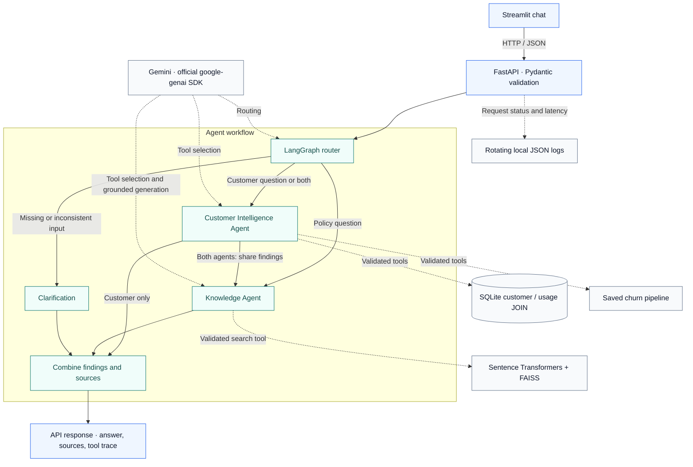

# Telecom Customer Intelligence AI Assistant

**Telecom policy answers, customer lookup and churn prediction in one conversation.**

A support question often needs more than a policy search. “Predict churn for CUST-001 and explain the cancellation policy” requires a customer record, a trained model and the right policy evidence. This project connects those steps through two specialised LangGraph agents, with Gemini selecting tools and Python controlling their execution.

The application runs locally with a FastAPI backend and a Streamlit chat interface. Answers include sources and a tool trace, so a reviewer can inspect what actually happened.

**Independent portfolio project.** No Vodafone affiliation or private Vodafone data. The six demonstration customers and eight DemoTel FAQs are fictional; the churn model is trained on a public, anonymised dataset.

[Getting started](#getting-started) · [Architecture](#architecture) · [Model results](#model-results) · [Testing](#testing-and-verification) · [Project guide](PROJECT_EXPLAINED.md) · [Technical audit](FINAL_TECHNICAL_AUDIT.md)

## What it does

| Ask the assistant | What runs behind the answer |
|---|---|
| “How do I activate international roaming?” | The Knowledge Agent searches local FAQ vectors and generates an answer grounded in retrieved excerpts. |
| “Show the profile for CUST-002.” | The Customer Intelligence Agent retrieves a profile through a parameterised SQLite JOIN. |
| “Predict churn for CUST-001.” | Customer lookup runs first, followed by inference with the saved Scikit-learn pipeline. |
| “Predict churn for CUST-001 and explain the cancellation policy.” | Both agents run in sequence and combine customer findings with cited policy guidance. |
| “What is the exact DemoTel roaming price in Japan?” | The assistant should express uncertainty because the FAQ does not contain that price. |
| “Predict churn for CUST-999.” | Customer lookup reports a missing record; no prediction or customer evidence is invented. |

Tools are read-only. The assistant cannot change accounts, cancel a service or apply an offer.

## Architecture



The agents have different prompts, permissions and responsibilities. The Customer Intelligence Agent can call `get_customer` and `predict_churn`; the Knowledge Agent can call `search_faqs`. For mixed requests, customer findings enter shared graph state before the policy step. This is sequential collaboration inside one application.

Gemini proposes function calls; the application validates and executes them. Safeguards include Pydantic schemas, tool allowlists, customer-ID matching, lookup before prediction, duplicate-call detection and a shared budget of five tool attempts. Customer planning is capped at three steps, knowledge search at one, and graph recursion at 12. SDK automatic function execution and automatic retries are disabled.

### Retrieval and grounding

Eight authored FAQs are split into 11 overlapping chunks of up to 50 words. A pinned `all-MiniLM-L6-v2` Sentence Transformer produces 384-dimensional embeddings. FAISS searches normalised vectors using inner products, equivalent to cosine similarity.

The default search returns up to three results above a 0.35 similarity threshold. Gemini receives the retrieved excerpts and must cite retrieved source IDs. Missing evidence or an unsupported answer produces uncertainty. The threshold is a retrieval heuristic; valid citations alone do not prove that every generated sentence is supported.

## Model results

The churn model uses the [UCI Iranian Churn dataset](https://archive.ics.uci.edu/dataset/563/iranian+churn+dataset): 3,150 anonymised records under [CC BY 4.0](https://creativecommons.org/licenses/by/4.0/). Features cover the first nine months; the churn label is measured at month twelve. Attribution, the source checksum and the feature dictionary are in [data/README.md](data/README.md) and [data/provenance.json](data/provenance.json).


| Model | Precision | Recall | F1 | ROC-AUC |
|---|---:|---:|---:|---:|
| DummyClassifier (`prior`) | 0.0000 | 0.0000 | 0.0000 | 0.5000 |
| Tuned Random Forest | **0.8696** | **0.8421** | **0.8556** | **0.9787** |

These are the saved results on **635 held-out rows**, with 2,515 rows used for training. The baseline predicts the majority class, which explains its zero precision, recall and F1 for churn.

The pipeline retains seven numeric and two categorical features. Numeric imputation/scaling and categorical imputation/one-hot encoding are fitted inside each training fold. IDs and target labels are excluded, along with age, status and the undocumented derived customer-value field.

Identical feature rows stay in the same group during both the outer split and cross-validation. `GridSearchCV` evaluates eight Random Forest configurations with three-fold grouped CV on the training partition, selecting by F1. The winning model has 100 trees, unrestricted depth, a minimum leaf size of four and balanced class weights. Mean CV F1 is **0.7818**; the classification threshold is fixed at 0.50. The saved estimator is fitted to training rows only.

Reproducibility records: [benchmark metrics](reports/benchmark.json), [grid-search results](reports/grid_search.csv) and [split indices](reports/split.json). The chart is generated directly from the benchmark by [scripts/render_benchmarks.py](scripts/render_benchmarks.py), using Matplotlib as an optional documentation dependency in a separate environment.

These results describe this public Iranian sample. They do not establish performance for Egypt, Vodafone customers or the fictional application records. Probabilities are uncalibrated and have not been validated for operational decisions.

## Technology stack

| Layer | Implementation |
|---|---|
| Language | Python 3.11–3.12; verified on Windows with Python 3.12.9 |
| LLM | Gemini `gemini-3.5-flash-lite` through official `google-genai` 2.33.0 |
| Orchestration | LangGraph 1.0.3 |
| API and validation | FastAPI 0.121.3, Uvicorn, Pydantic 2.12.5 |
| Interface | Streamlit 1.51.0 |
| Machine learning | Scikit-learn 1.7.2, Pandas, NumPy and Joblib |
| Retrieval | Sentence Transformers 5.1.2, CPU PyTorch and FAISS 1.12.0 |
| Storage and tests | Python `sqlite3`, Pytest and HTTPX |

Direct dependencies are pinned in [requirements.txt](requirements.txt); [requirements-lock.txt](requirements-lock.txt) records the audited environment. Python 3.13+ is outside the supported range. Python 3.11 and other operating systems have not been verified.

## Getting started

### 1. Install on Windows

Use Python 3.12 and open a PowerShell terminal. Git must be installed to clone the repository.

```powershell
git clone https://github.com/Amrafik/telecom-customer-intelligence-ai-assistant.git
cd telecom-customer-intelligence-ai-assistant

python --version
python -m venv .venv
.\.venv\Scripts\python.exe -m pip install torch==2.5.1 --index-url https://download.pytorch.org/whl/cpu
.\.venv\Scripts\python.exe -m pip install -r requirements-lock.txt
.\.venv\Scripts\python.exe -m pip install -e . --no-deps

if (-not (Test-Path -LiteralPath .env)) { Copy-Item -LiteralPath .env.example -Destination .env }
```

In VS Code, install the Python extension and select `.venv\Scripts\python.exe` with **Python: Select Interpreter**. These commands use the interpreter directly, so activation is optional. Initial installation requires network access and several hundred MB for dependencies and embedding weights. A fresh installation on a separate machine has not yet been verified.

### 2. Build local resources

Run these commands in order from the repository root:

```powershell
.\.venv\Scripts\python.exe -m telecom.prepare_data
.\.venv\Scripts\python.exe -m telecom.init_db
.\.venv\Scripts\python.exe -m telecom.train
.\.venv\Scripts\python.exe -m telecom.build_index
```

The included public CSV is reused if present. These commands record provenance, seed the fictional SQLite database, save the trained churn pipeline, and download the pinned embedding model to build the FAQ index. Runtime retrieval then uses local model files. Rebuild the index after changing FAQ content or embedding settings.

Generated models, embeddings, the index, SQLite database, logs and `.env` are excluded from Git. They are recreated locally from the included source data and seeds. Database seeding preserves existing rows.

### 3. Choose a mode

| Setting | Behaviour |
|---|---|
| `APP_MODE=offline` | Deterministic routing, fixed tool-selection rules and retrieved excerpts. The real graph, SQL, model and vector search still execute. No Gemini calls. |
| `APP_MODE=live` | Gemini performs routing, function selection and grounded policy generation. Python executes tools and formats customer/model facts. |

The example configuration defaults to offline mode. For live mode, obtain a key from [Google AI Studio](https://aistudio.google.com/apikey) and edit the ignored `.env` file:

```dotenv
APP_MODE=live
GEMINI_API_KEY=your_key_here
GEMINI_MODEL=gemini-3.5-flash-lite
GEMINI_TIMEOUT_SECONDS=30
```

Keep the real key out of source files and `.env.example`. Existing environment variables override `.env`; restart the servers after configuration changes. Model access, free-tier eligibility and quotas depend on the account. There is no silent fallback to another model or mode.

### 4. Start the application

In one terminal, start the backend:

```powershell
.\.venv\Scripts\python.exe -m uvicorn telecom.api:app --host 127.0.0.1 --port 8000
```

In a second terminal, start the interface:

```powershell
.\.venv\Scripts\python.exe -m streamlit run telecom/ui.py --server.address 127.0.0.1 --server.port 8501 --browser.gatherUsageStats false
```

Open the [chat interface](http://127.0.0.1:8501), [interactive API documentation](http://127.0.0.1:8000/docs) or [health endpoint](http://127.0.0.1:8000/health). First use may take several seconds while local resources load. Stop each server with Ctrl+C.

This is an unauthenticated local demonstration. Keep both services bound to `127.0.0.1`.

## REST API

| Method and endpoint | Purpose |
|---|---|
| `GET /health` | Check database, churn model and FAQ index readiness; report mode and configured model. Does not call Gemini. |
| `POST /chat` | Accept a message and optional customer ID; return answer, route, sources, tool trace, errors, request ID and latency. |
| `GET /customers/{customer_id}` | Return a validated fictional customer profile using the SQLite JOIN. |
| `POST /predict` | Return churn probability, predicted class, threshold, model version and a dataset caveat. |

For example, with the backend running:

```powershell
Invoke-RestMethod -Method Post -Uri http://127.0.0.1:8000/chat -ContentType "application/json" -Body '{"message":"Predict churn for CUST-001 and explain the cancellation policy."}'
```

Customer IDs follow `CUST-001`. Invalid payloads return 422; unknown customers return 404 on direct lookup/prediction. Unavailable dependencies/provider failures return 503 where handled at the API boundary. Chat can return HTTP 200 with partial findings or explicit tool errors, so consumers must inspect `errors` and `tool_trace`. Unexpected exceptions produce a sanitised 500 response.

## Testing and verification

Build the local resources before running the suite:

```powershell
.\.venv\Scripts\python.exe -m pip check
.\.venv\Scripts\python.exe -m pytest -q --junitxml=reports/pytest.xml
.\.venv\Scripts\python.exe -m telecom.evaluate
```

Recorded checks on **23 October 2026**:

| Check | Result | Scope and evidence |
|---|---:|---|
| Automated tests | **88 passed** | API, SQL JOIN, ML training/inference, retrieval, graph routing, tool validation, Gemini SDK contracts and Streamlit integration. [JUnit report](reports/pytest.xml). |
| Offline evaluation | **22 / 22** | Actual local tools and deterministic orchestration; no live LLM decisions. [Evaluation report](reports/evaluation.json). |
| Limited live Gemini audit | **2 / 2** | Mixed-agent request and unsupported-price uncertainty, with executed tools and sources checked. [Live audit](reports/gemini_live_audit.json). |
| Local runtime smoke checks | **8 / 8** | Running API/UI readiness, prediction, validation and error handling. [Runtime report](reports/final_runtime_smoke.json). |
| Earlier full live Gemini suite | **7 / 7** | FAQ, lookup, prediction, mixed request and failure cases. This run predates the final cleanup. [Historical live report](reports/gemini_live_evaluation.json). |

The automated suite blocks external sockets and simulates Gemini responses; it makes no paid API calls. Those tests validate integration contracts, not live model behaviour. Saved live reports check tool execution against SQL rows, pipeline output and retrieved evidence. They are small smoke tests, not an exhaustive answer-quality or security evaluation. The latest automated run also reported four upstream deprecation warnings.

Live checks are opt-in and consume API quota. Run the smaller check first:

```powershell
.\.venv\Scripts\python.exe -m telecom.evaluate_gemini --case combined --case unsupported_price
```

To run all seven live scenarios:

```powershell
.\.venv\Scripts\python.exe -m telecom.evaluate --live
```

Live cases pause for 15 seconds between requests. A full run replaces the full live report; selected cases write the limited audit report. The [technical audit](FINAL_TECHNICAL_AUDIT.md) explains the checks, their timing and their limits.

## Monitoring and safeguards

The backend writes rotating JSON logs containing UTC timestamps, request IDs, route/tool selection, status, error codes and latency. Raw questions, customer profiles and API keys are omitted. To inspect retained local activity:

```powershell
.\.venv\Scripts\python.exe -m telecom.monitor
```

The summary reports request/tool counts, failures and p50/p95 latency. These are local observations, not load-test results. Logging is intended for one API process.

SQLite lookups bind parameters rather than interpolating input into SQL. Foreign keys link `customers` to `usage_metrics`, and validated records feed the same feature definitions used in training. Customer-ID matching prevents an agent from switching demo records within a request; it does not replace authentication for real data.

## Repository guide

```text
telecom/
  api.py, ui.py                 REST backend and Streamlit client
  workflow.py, tools.py         LangGraph state, agent nodes and bounded execution
  llm.py, gemini_llm.py         Prompts, citation checks and Gemini SDK integration
  rag.py, build_index.py        FAQ chunking, embeddings and FAISS retrieval
  ml.py, train.py               Shared features, SQL lookup, inference and tuning
  prepare_data.py, init_db.py   Public data provenance and fictional database setup
  config.py, schemas.py        Settings and input/output contracts
  errors.py                    Application errors
  monitoring.py, monitor.py    Structured logs and local summaries
  evaluate.py                  Offline regression cases
  evaluate_gemini.py           Opt-in live checks
data/                          Public training CSV, provenance, fictional seeds
reports/                       Benchmarks, splits and recorded verification
tests/                         Automated regression tests
docs/assets/                   Benchmark visual
scripts/render_benchmarks.py   Rebuild the chart from saved metrics
PROJECT_EXPLAINED.md            Code walkthrough and interview questions
FINAL_TECHNICAL_AUDIT.md         Requirement-by-requirement assessment
```

For a demonstration, start with roaming retrieval, then customer lookup, then the combined churn/cancellation question. Inspect the returned sources and tool trace before showing the missing-customer and unsupported-price cases. [PROJECT_EXPLAINED.md](PROJECT_EXPLAINED.md) walks through the implementation and design decisions in detail.

## Limitations

- Local serving only: no public cloud deployment, authentication, production load testing or real support/billing integration.
- Six fictional customers and eight English FAQs provide a small demonstration, without chat memory or broad telecom-policy coverage.
- Public-data benchmarks do not establish local-market generalisation, probability calibration, fairness or business value.
- Retrieval similarity and citation validation reduce some errors; neither guarantees factual entailment or resistance to every prompt injection.
- Gemini availability and API quotas can change. Send only fictional demo data; review the provider's data-use terms before using another dataset.
- Joblib artifacts must come from a trusted source. Validation does not make untrusted pickle files safe to load.

## License and attribution

Project code is available under the [MIT License](LICENSE). The included UCI dataset retains its separate **CC BY 4.0** licence.

Dataset citation: *Iranian Churn [Dataset]. (2020). UCI Machine Learning Repository.* [doi:10.24432/C5JW3Z](https://doi.org/10.24432/C5JW3Z).
