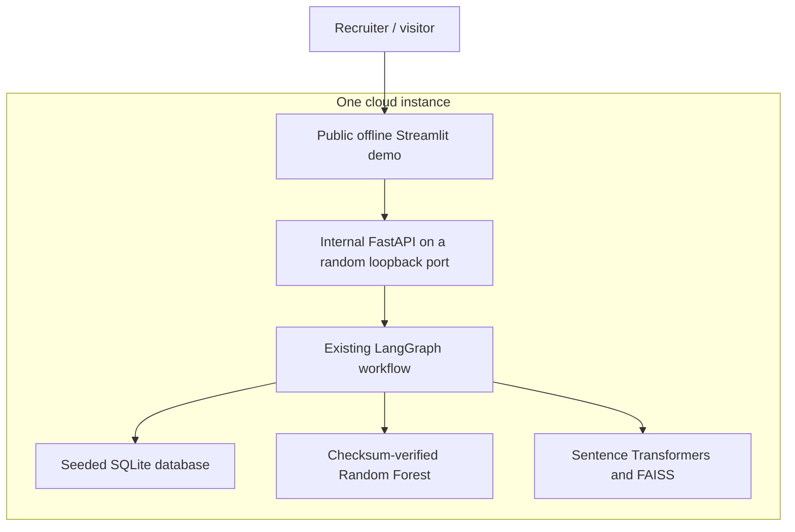

# Hosted Streamlit Community Cloud demo

The [public hosted demo](https://amrafik-telecom-ai.streamlit.app/) runs the existing SQLite customer lookup, Scikit-learn churn pipeline, FAISS retrieval and LangGraph with deterministic routing in **offline mode only**. It makes no Gemini API calls. The full local application supports Gemini-powered routing, function calling and grounded generation, with [recorded live verification](../reports/gemini_portfolio_smoke.json).

The owner has deployed the demo publicly. Optional private sharing is a platform setting, not the current access claim. Public availability does not establish production capacity, an SLA or long-term reliability.

## Architecture



`deploy/streamlit/app.py` is a separate entry point. It never imports the local `telecom/ui.py` or local `telecom/api.py` server entry point. The backend listens on `127.0.0.1` at a pre-bound operating-system-assigned port; it is not a separately public API. Server-side HTTP calls carry a random internal token, which is not rendered in the interface or logged. This token is not a recruiter login. Optional private sharing can restrict viewers through the platform; the current demo is public.

`telecom/api_factory.py` contains the same REST handlers formerly defined in `api.py`. The local entry point still exports `api.app` and `api.create_app`. This split avoids constructing the local `.env`-configured assistant during a cloud import. Both entry points reuse the same handlers and business logic.

## Files and initialization

| File | Purpose |
|---|---|
| `deploy/streamlit/app.py` | Offline cloud UI, startup, evidence rendering and shared runtime cache. |
| `deploy/streamlit/requirements.txt` | Linux x86-64 / Python 3.12 dependencies, including an explicit official CPU PyTorch wheel. |
| `deploy/streamlit/secrets.toml.example` | Non-secret demo limits to paste into cloud settings. |
| `deploy/streamlit/artifacts/churn_pipeline.joblib` | Byte-for-byte copy of the existing trusted fitted pipeline; approximately 1.49 MiB. |
| `deploy/streamlit/artifacts/manifest.json` | Artifact checksum, sklearn version, dataset/model identity and benchmark fingerprint. |
| `scripts/package_cloud_model.py` | Recreate the packaged artifact from the existing trained local model; does not train. |
| `telecom/cloud_resources.py` | Explicit offline settings, artifact verification, SQLite seed and FAISS/cache initialization. |
| `telecom/cloud_runtime.py` | Shared backend lifecycle, readiness, internal token and request admission limits. |
| `tests/test_cloud.py` | Credential isolation, artifacts, startup/restart, UI, cache and usage safeguards. |

On first use, startup verifies the packaged model **before Joblib deserialization**, checks its sklearn version and benchmark fingerprint (with Git line endings normalized), seeds `.cache/cloud/customers.sqlite3`, and loads the FAQ index. If the cloud index or its embedding files are missing/stale, the existing index builder downloads the pinned public embedding model and builds eleven vectors. It uses separate cloud paths; it does not overwrite the local model, database, embeddings, FAISS index or benchmark reports. There is no training or GridSearchCV at startup.

The embedder returned by a cold build is reused by the retriever, avoiding a second load. Later requests reuse one `Assistant`, predictor and retriever. Streamlit's resource cache and a process-level registry prevent duplicate backend startup across reruns and cache clears. Parallel startup calls are serialized. A stopped backend is restarted against the same loaded resources. A complete process restart reloads resources once from the saved cache; a lost filesystem rebuilds the cache.

The checksum manifest detects accidental changes against the reviewed repository snapshot. It is not a cryptographic signature or a defence against someone who can replace both code and artifact. Load only this project's reviewed artifacts.

## Credentials and offline enforcement

The cloud resource factory passes explicit defaults with `Settings(_env_file=None, ...)`, forces `app_mode="offline"` and supplies an empty key. The local `.env` is never a cloud configuration source. Environment variables such as `APP_MODE=live` and `GEMINI_API_KEY` cannot turn this entry point live. The cloud backend also rejects a service configured with live mode or a non-empty key.

Do **not** paste a Gemini key for this demo. If live support is added in a separately reviewed change, the credential must be entered directly in Community Cloud Secrets, never in Git, screenshots or logs. The present entry point intentionally cannot be enabled live through a configuration toggle. Per-Gemini-call pacing, project-tier checks and durable spending controls have not been implemented for live hosting.

`.streamlit/secrets.toml` and other files named `secrets.toml` are ignored. The checked-in example contains limits only. Existing `.env` contents and local configuration are preserved.

## Shared request controls

Defaults apply across all visitors, not separately to each browser session:

- One active business request at a time. A concurrent request returns 429 immediately rather than creating an unbounded queue.
- Six admitted business requests per rolling minute.
- One hundred admitted business requests per UTC day.
- Invalid payloads and failed admitted requests consume the allowance. Unauthorized requests are rejected before admission.
- Authenticated `/health` checks remain available and do not consume the allowance.
- `enabled=false` disables business requests while preserving health checks.

The guards cover chat, customer lookup and prediction on the cloud-only API. Original Pydantic validation, tool budgets, read-only SQL and structured logging remain in use. Admission rejections are logged without tokens, questions or customer records. The internal HTTP client's proxy environment is disabled so loopback calls do not accidentally use an external proxy.

The daily count is stored in `.cache/cloud/usage.sqlite3` using a transaction, so it survives internal-server restarts and new runtime objects using that file. The active-request guard and rolling-minute window are process-local. These are controls for one shared instance, not a distributed limiter. A fresh filesystem resets counters. There are **zero Gemini calls** in this hosted demo, so counter loss cannot create Gemini charges.

## Check locally without disturbing the existing app

Use the existing Windows environment; do not install the Linux wheel there:

```powershell
.\.venv\Scripts\python.exe scripts/package_cloud_model.py
.\.venv\Scripts\python.exe -m pytest -q --junitxml=reports/cloud_regression.xml
.\.venv\Scripts\python.exe -m streamlit run deploy/streamlit/app.py --server.address 127.0.0.1 --server.port 8502
```

Open `http://127.0.0.1:8502`. The cloud wrapper creates its own internal backend, so do not start another Uvicorn process for it. Your existing app at port 8501 can continue using its original backend at port 8000. Stop the trial Streamlit process with Ctrl+C; its exit handler stops the internal server.

Try customer profile lookup, churn prediction, roaming retrieval, a combined churn/cancellation question and an unknown ID. Inspect sources and tool traces. The offline policy answer is a retrieved excerpt rather than generated text; relevance does not guarantee that the excerpt answers every question.

## Deployment reference and optional private sharing

The public demo is already deployed. These steps document setup/recovery and how the owner can optionally restrict access; they do not imply that private sharing is currently enabled.

1. Review the latest verification report and artifact manifest. Use the verified `main` branch of the existing GitHub repository.
2. Sign in at `share.streamlit.io` with the GitHub account that administers `Amrafik/telecom-customer-intelligence-ai-assistant`.
3. Choose **Create app → existing repository**. Select that repository and the approved branch. Use **`deploy/streamlit/app.py`** as the entry point, not `telecom/ui.py`.
4. In **Advanced settings**, explicitly select **Python 3.12**. The CPU wheel is pinned to CPython 3.12 / Linux x86-64. Community Cloud searches beside the entry point before the repository root, so it should use `deploy/streamlit/requirements.txt`. Check the install logs to confirm that it installs CPU Torch and no NVIDIA packages. No Docker, separate backend host or GPU is needed.
5. For a new setup, paste the following into **Secrets**, with no API key. Start with requests disabled while reviewing access settings:

   ```toml
   [cloud]
   enabled = false
   requests_per_minute = 6
   requests_per_day = 100
   ```

6. Review **Settings → Sharing → Who can view this app**. Keep public access for the current public offline demo, or optionally select **Only specific people can view this app** and add intended viewers. The platform may email invitations when viewers are added; this guide does not send invitations. Gemini remains disabled in either case.
7. After confirming the intended sharing setting, set `enabled=true` in Secrets and reboot. Wait for the pinned embedding download and readiness. Open a second session and verify both sessions share the allowance and backend. Check actual instance memory; Linux compatibility alone does not establish Community Cloud capacity.
8. Run the five example questions above. Confirm mode is Offline, the score matches the local benchmarked pipeline, citations contain the actual FAQ excerpts, and the unknown ID returns an explicit error without a fabricated record.
9. Reboot through the app management panel. Confirm readiness and the same predictions. Be prepared for cache reconstruction if the platform removes local storage.
10. Set `[cloud].enabled=false` and reboot to test the stop switch. Restore it deliberately after checking that requests were disabled. Reboot after changing any limit; a running registry rejects conflicting configuration instead of silently running multiple backends.
11. Check access from an ordinary non-owner session. If private sharing was selected, verify that a non-invited viewer is blocked. Review cloud logs for unexpected errors. Keep a short recording available for sleeping apps, model-download failures or unavailable free resources.

## Limits and costs

Community Cloud hosting is free, and this offline configuration has no Gemini usage charges. It needs CPU time, RAM and disk for Python dependencies and a local embedding model. FAISS and the Random Forest are small; PyTorch and embedding inference dominate the footprint. One-thread numerical settings and one active request reduce peaks but do not guarantee a memory ceiling.

The platform's published resource estimates are dated and can change. Apps can sleep after twelve hours without traffic, local file persistence is not guaranteed, and free hosting provides no promised recruiter response time. The working public demo does not establish long-term memory headroom, availability or load capacity. Optional private sharing adds a sign-in step for recruiters. Keep all data fictional; no operator accounts are connected.

Official references: [dependency selection](https://docs.streamlit.io/deploy/streamlit-community-cloud/deploy-your-app/app-dependencies), [secrets](https://docs.streamlit.io/deploy/streamlit-community-cloud/deploy-your-app/secrets-management), [private sharing](https://docs.streamlit.io/deploy/streamlit-community-cloud/share-your-app), [resources and sleep](https://docs.streamlit.io/deploy/streamlit-community-cloud/manage-your-app), [local storage](https://docs.streamlit.io/develop/concepts/connections/connecting-to-data), [CPU PyTorch](https://pytorch.org/get-started/previous-versions/).

## Historical predeployment verification

The full Windows/Python 3.12.9 regression suite passed **143 tests** in **44.80 seconds**, with four upstream deprecation warnings. This includes twenty new cloud tests. A separate offline evaluation passed **30/30** with no provider calls. The previous default suite's 123-test report is preserved; the expanded result is in `reports/cloud_regression.xml`.

The deployment requirements were installed in a fresh Ubuntu WSL / Python 3.12.3 virtual environment, with `torch==2.5.1+cpu`, no CUDA availability, and a passing `pip check`. A real cold-start smoke downloaded the pinned public embedding model, built FAISS in a fresh temporary cache and passed **10/10 checks**, including HTTP readiness, model prediction, customer lookup, mixed-agent tool traces/sources, unknown IDs, internal authentication, backend restart and saved-index reuse. It made zero Gemini calls. See `reports/cloud_linux_smoke.json`.

That Linux run took **19.03 seconds** for startup and initial checks, with a **681.5 MiB peak resident set** for the API thread, Streamlit imports and resource initialization. This is not a whole Community Cloud container measurement. It leaves little or no margin at the platform's lowest published memory figures; do not assume the maximum allocation. Actual hosted memory and ongoing availability require separate observation despite the subsequent successful deployment. The test environment was Ubuntu, not the platform's documented Debian environment.

The new twenty cloud-specific tests also have a separate Linux run report in `reports/cloud_linux_pytest.xml`; consult the consolidated `reports/cloud_preparation.json` for its actual result. Candidate-file secret scanning, ignored secret paths, unchanged original artifacts and deployment-file checks from that preparation are recorded there. Publishing the configuration did not itself deploy the app; the owner subsequently deployed the public offline demo linked above. These reports describe preparation checks, not managed-host load tests.

## Final publication checks

The final regression initially exposed a logging test that read malformed historical development-log content. Test and evaluation processes had also shared that single-process log path. Pytest now writes to a temporary log directory for each test, and the logging assertion parses that actual test log strictly. Runtime logging is unchanged. Publication checks run sequentially; the final rerun and exact staged credential/size scan are recorded in `reports/cloud_preparation.json`.

## Recruiter notice and Streamlit controls

The cloud UI displays a short notice beneath the title: routing is deterministic, Gemini is not called, and applicable requests execute the actual SQLite lookup, Scikit-learn model, FAISS retrieval and LangGraph workflow. A second short line distinguishes the Gemini-powered local version and links to the repository's implementation and recorded live evaluation evidence. The sidebar retains its Offline label without repeating the notice.

Scope replies now distinguish unrelated questions, capabilities, architecture and refusal reactions using deterministic offline rules. These replies identify the mode explicitly and execute no tools. The cloud UI passes only the latest allowlisted refusal-intent hint for a follow-up; it sends no chat history or remembered customer ID. Live classification remains exclusive to the local Gemini version; cloud credential isolation and shared limits are unchanged.

The intent-handling follow-up passed **173 Windows regression tests**, **36 offline evaluation cases** and a repeated **38-test Linux cloud/conversation subset**, including real UI refusal/follow-up requests. Current evidence is in [Windows JUnit](../reports/intent_regression.xml), [Linux JUnit](../reports/intent_linux_pytest.xml) and [offline evaluation](../reports/evaluation.json). Separate local live checks passed 5/5; those Gemini calls do not occur in the hosted wrapper. The older preparation/notice reports below remain historical snapshots.

Only the cloud entry point sets `client.toolbarMode="viewer"`, using Streamlit's supported setting to hide developer options and its native Deploy control. The setting does not change access permissions. Community Cloud may supply additional owner controls externally, and their exact appearance has not been checked after this update. Use an ordinary non-owner session to assess the public recruiter view, or an invited viewer account if private sharing is enabled. See [Streamlit app chrome](https://docs.streamlit.io/develop/concepts/architecture/app-chrome).

The focused cloud and local UI regression run passed **21 tests** with four upstream warnings. `reports/cloud_notice_pytest.xml` contains the results and `reports/cloud_notice_verification.json` records scope and limitations. No new Gemini calls were needed; the live-test statement refers to preserved earlier reports, not this UI check.
